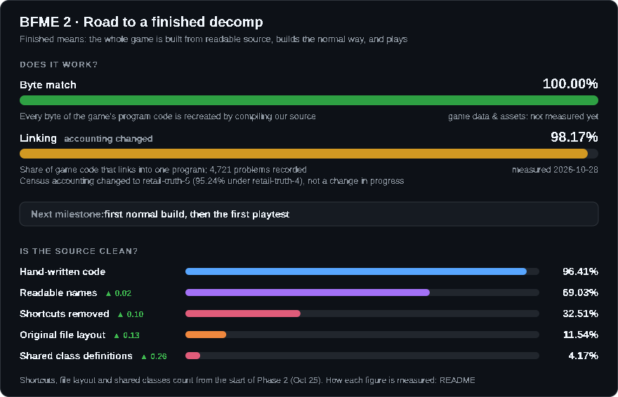
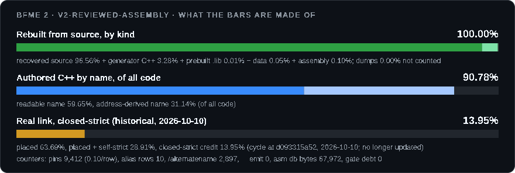
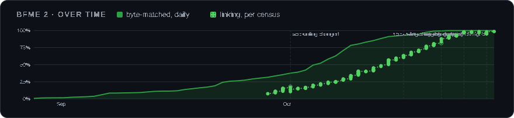
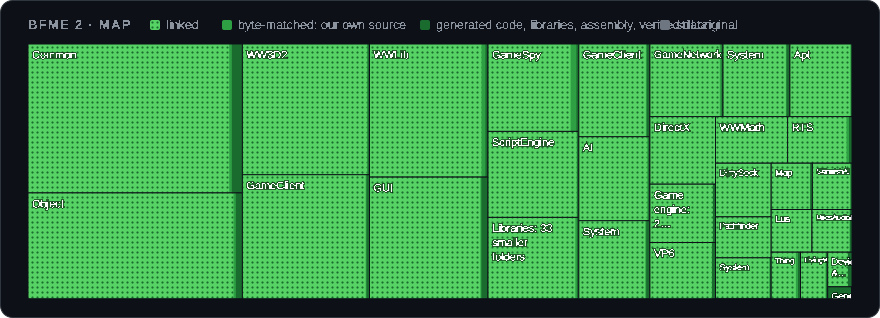

# BFME 2 Source Code

Goal: Source code that rebuilds BFME 2's engine binary (`game.dat`) byte-for-byte, and game modernization improvements that you've only seen in your dreams.

[Join our Discord to participate!](https://discord.gg/wCvA2XqPUT)

## What?

* We rewrite the game's code as C++, one small piece at a time.
* Each piece must turn back into the exact same bytes as the original game.dat (BFME 2, version 1.06).
* When every piece matches and links, the whole game is open source, and we can fix bugs and make mods.

[](tools/progress.py)

[](tools/progress_v2.py)

### What the bars measure

* **Rebuilt from source**: code rebuilding to the original game.dat's exact bytes, including generated code, attached prebuilt libraries, verified data in `.text`, and explicitly reviewed reconstructed assembly (the clean-room MMX IDCT family, documented register/stack runtime entries and the patched-target signature check). Retail dumps remain excluded.
* **Game code in C++\***: includes generated C++ and intentionally retained assembly. Counts executable game code; libraries and embedded data are excluded. Authored C++, generated C++ and reviewed assembly remain separate in the detailed breakdown.
* **Linking**: executable game code in files that link cleanly, including generated C++ and reviewed assembly assessed by the census. Libraries and embedded data are excluded from both sides. Assembly without a recorded assessment receives no credit. Both totals use the same census tree; historical authored-only totals remain available. Each file is judged on its own: its names resolve, with no duplicate or wrong copy.
* **Strict link check** (the line under the bars): the whole tree linked at the original game's addresses with every reference checked ([`tools/link_cycle.py`](tools/link_cycle.py)). *Self-strict* is code placed at its original address whose own references land where the original's do; *fully linked* also needs everything it reaches to be right, so it waits on code nobody has converted yet. Both are shares of the original's whole code section, libraries included (the Linking bar counts only the game's own code). **The line on the card is historical**: it comes from the last receipt committed to this repository (date and commit shown), and receipts are no longer committed. Newer measurements are to be published as link-cycle bundles ([`tools/cycle_artifacts.py`](tools/cycle_artifacts.py)); none has been published yet.
* **Readable names**: declared names that are not placeholders (files, types, functions, members, globals, parameters and locals); not proof of original EA names. Its daily change compares the displayed percentages in percentage points; `· 0.00` means unchanged. The first post has no comparison.

<details open>
<summary><b>Progress over time and code map</b></summary>

[Interactive report](https://open-bfme.github.io/Open-BFME-2/)





</details>

## Status

Retail statically links Visual C++ 7.1's own support libraries, and `tools/lib_probe.py` places
their members without needing an attached row to anchor a window. The vendored
DirectX archives do **not** place — BFME 2 links a later SDK than the Summer
2003 `d3dx9`/`dxerr9` kept here for BFME 1. Flag calibration is proven: 756
Open-BFME-1 bodies transfer to `game.dat` verbatim, so the reference sweeps are
wide open.

## Roadmap

* [ ] BFME 2 Source Code
* [ ] 60/120 FPS
* [ ] Memory fix
* [ ] Better crash logs
* [ ] Multi CPU
* [ ] World builder Source Code
* [ ] Bigger maps
* [ ] RotWK support

Off-host delay is already fixed by the community (BFME 2 patch 1.09v3, RotWK 2.02 v9), so it is deliberately not on this roadmap.

## How You Can Help

Clone the repo and give your AI agent this exact prompt — measured on six agent
sessions, a vaguer prompt reliably produces zero progress:

> Read AGENTS.md and follow it. Loop: take the served candidate's whole file,
> convert bodies to byte-exact C++, bank each verified body as its own commit,
> and before stopping run `python3 tools/progress.py origin/master` — if C++
> exact is +0 bytes, keep going. Make a PR when you have a few landed bodies.

Each commit in the PR is one verified function, and I will be able to merge it.

!! All such AI-generated PRs are appreciated !!

## Build

The baseline executables are committed directly; the MSVC 7.1 toolchain and the
Zero Hour reference source live in the Open-BFME-1 submodule, so clone with
submodules:

```bash
git clone --recurse-submodules https://github.com/Open-BFME/Open-BFME-2.git
cd Open-BFME-2
./tools/setup_hooks.sh   # enable the pre-commit byte-check (git won't do this from a clone)
./build.sh               # verify every tracked function against retail   (.\build.ps1 on Windows)
```

On Ubuntu 24.04, use **WineHQ Wine 11** (`winehq-stable`), not the distro's
Wine 9.0, which can hang when running the MSVC 7.1 compiler. Initialize a 32-bit
Wine prefix before building on Linux:

```bash
export WINEARCH=win32
export WINEPREFIX="$HOME/.wine-bfme2"
wineboot -i
./build.sh Code/Libraries/Source/Compression/ZLib/trees.c
```

Keep `WINEPREFIX` set for subsequent builds. When running builds from a systemd
service, a `SystemCallArchitectures=native` restriction blocks Wine's 32-bit
preloader (`SIGSYS`); use a build session that permits 32-bit execution rather
than changing the security policy of an unrelated service.

Units marked `// dxsdk` compile against the DirectX 9.0c SDK (August 2005), vendored in `vendor/dxsdk-aug2005/` (see its `PROVENANCE.txt`).

`setup_hooks.sh` also registers `tools/merge_rows.py` as the merge driver for the
ledgers in `reverse/`, so a rebase does not bring back rows the other side deleted
or edited. A clone that skipped it gets the driver on its first commit attempt that
reaches the pre-commit hook, if the hook can write `.git/config` (it makes three
attempts, then leaves it for a later commit). A clone that only pulls keeps git's
built-in union merge, unless it is a linked worktree: worktrees share one config, so
one registers for all. A worktree older than the driver then merges ledgers as
built-in union did, which needs `git merge-file --diff-algorithm` (git 2.44 or newer);
with an older git that merge stops on a conflict. To check:
`git config --get merge.union.driver` prints a command naming `tools/merge_rows.py`,
or nothing if the driver is not registered.

To check a single function while iterating, pass its file or name — a few seconds instead of the full run:

```bash
./build.sh Code/Libraries/Source/Compression/ZLib/trees.c
```
